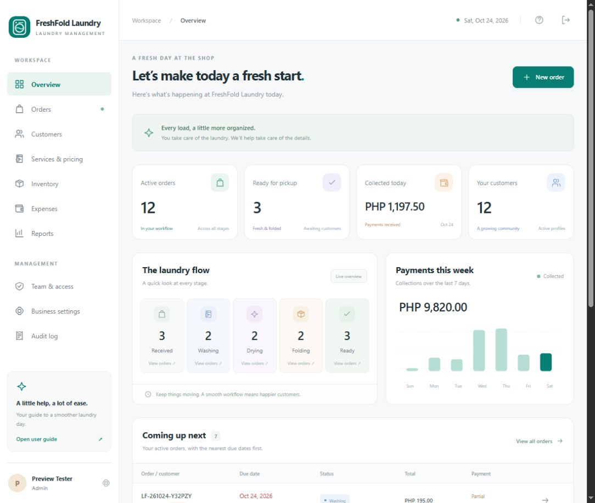

# FreshFold · Laundry Shop Management

A configurable, single-shop laundry management MVP built with **Laravel 12, PHP 8.2+, MySQL 8, Blade, CSS, and lightweight JavaScript**. Designed for Laragon and localhost testing. No frontend build or Node server is required.



## What you can do

- Customize the business logo, name, tagline, address, contacts, receipt message, currency, timezone, and sales tax.
- Manage customers, preferences, order history, and archived profiles.
- Configure services and prices by kg, piece, load, or pair.
- Create orders with care notes, storage labels, pickup times, priority, discounts, and tax.
- Track Received → Washing → Drying → Folding → Ready → Completed, with staff history.
- Record deposits and full payments; print branded claim receipts or save them as PDFs.
- Record full payment refunds and cancellations without removing original financial entries.
- Track supplies, deliveries, usage, reorder alerts, expenses, reports, and CSV exports.
- Manage four staff roles, account access, required initial password changes, and audit history.
- Read operational data through a protected, versioned session JSON API.

Security controls include server-side RBAC, password hashing, CSRF protection, escaped output, validated/re-encoded logo uploads, throttling, security headers, transactional financial workflows, row locks, duplicate-payment protection, and session revocation. No software can guarantee immunity from every attack; production still requires proper hosting, maintenance, and security review.

## Start locally

Start **MySQL in Laragon**. From PowerShell in this directory:

```powershell
composer install
Copy-Item .env.example .env
php artisan key:generate
# Edit DB_* in .env for your Laragon connection.
php scripts/check-database.php --create
php artisan migrate
php artisan laundry:install --demo --no-interaction
php artisan serve --host=127.0.0.1 --port=8000
```

Open **http://127.0.0.1:8000**. The installer prints the generated temporary password for `admin@freshfold.test`; change it at first sign-in. **If this workspace was already set up, keep its .env, APP_KEY, and database. Run only the server command.** Installation refuses to overwrite existing accounts.

For a clean business installation, use `php artisan laundry:install --email=owner@example.com --name="Shop Owner"` instead of the demo command. Set currency and timezone before the first real order. To move from a demo to real operations, use a new empty database so fictional records are not mixed with business records.

## Documentation

| Guide | Contents |
| --- | --- |
| [Setup](docs/SETUP.md) | Laragon, environment, installation, testing, troubleshooting |
| [User manual](docs/USER_MANUAL.md) | Daily shop workflow and roles |
| [API](docs/API.md) | Authentication, JSON endpoints, form contracts |
| [Architecture](docs/ARCHITECTURE.md) | Project map, data model, financial rules, customization, MVP scope |
| [Security](docs/SECURITY.md) | Controls, trust boundaries, verification, deployment responsibilities |
| [Operations](docs/OPERATIONS.md) | Backups, restoration, upgrades, account recovery, monitoring |
| [Acceptance](docs/ACCEPTANCE.md) | Requirement-to-feature map and verification commands |

The in-app **User guide** provides a quick operational reference.

## Roles

| Role | Access |
| --- | --- |
| Administrator | All operations, staff accounts, branding, audit log |
| Manager | Orders, customers, payments/refunds, services, supplies, expenses, reports |
| Cashier | Orders, customers, processing, payments, receipts |
| Operator | View/process orders and manage supplies |

Permissions are checked on the server, not just by hiding navigation. The overview's aggregate figures are visible to all staff roles.

## Verify

```powershell
composer test
composer audit
php artisan view:cache
npm run check
# Optional real-engine tests; resets the dedicated test database only:
php scripts/check-database.php --test --create
php vendor/phpunit/phpunit/phpunit --configuration phpunit.mysql.xml
```

Default tests use in-memory SQLite. The MySQL configuration targets only `laundry_shop_test`. Do not point tests at real business data.

## MVP scope

One business/branch, manual intake and stock tracking, fixed processing stages, external funds handling, full refunds per payment, printable claim receipts, and staff operations. Automated SMS/email, delivery scheduling, payment gateways, partial refunds of individual payments, multi-branch accounting, payroll, machine control, and statutory e-invoice certification are not included. See Architecture for extension points.

The sample SVG logo and decorative laundry illustration were created for this project and can be replaced. No downloaded brand assets or external image/font services are needed at runtime.
