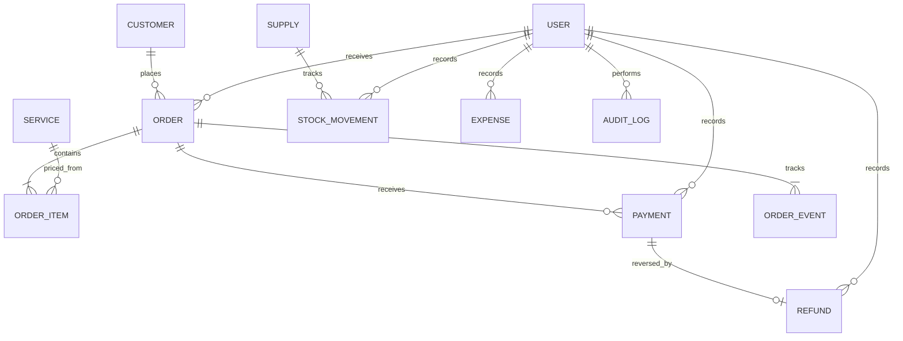

# Architecture and customization

## Stack

Laravel 12 on PHP 8.2+, traditional MySQL 8, Blade templates, responsive CSS, and vanilla JavaScript. Authentication uses Laravel's session guard and database sessions. No Node process is required to run the application. Composer dependencies are pinned in `composer.lock`.

The single-branch application renders pages on the server. Search, filtering, totals, and mutations execute on the backend. JavaScript enhances navigation, password visibility, printing, confirmation prompts, and order estimates; it is never the authority for money or permissions. The application makes no external font or image requests. The original sample logo is a local SVG asset; user logo uploads only accept and re-encode raster images.

## Project map

| Location | Responsibility |
| --- | --- |
| app/Http/Controllers | HTTP validation, orchestration, views/JSON |
| app/Http/Middleware | Permission checks, active account checks, required password change, security headers |
| app/Models | Entities, relationships, role permission definitions |
| app/Services/OrderService.php | Transactional order creation, stage transitions, payments, refunds |
| app/Support/Money.php | Decimal-string to integer-cents conversion and rounding |
| app/Rules/PasswordBytes.php | Bcrypt-safe maximum password size |
| database/migrations | Versioned MySQL schema and indexes |
| database/seeders | Starter catalog and optional fictional sample shop |
| resources/views | Layouts, pages, components, friendly errors, receipts |
| public/css/app.css | Design tokens, application, login, responsive, print styles |
| public/js/app.js | Progressive browser interactions and order estimates |
| public/images/logo.svg | Original editable sample logo |
| routes/web.php | Protected browser routes and read-only session API |
| routes/console.php | First-owner install and console-assisted password recovery |
| tests/Feature/LaundryTest.php | Workflow, financial, authorization, CSRF, and upload regression tests |
| scripts | Local database check and server startup |

Runtime assets live in `public/css` and `public/js`. The optional package.json exposes a JavaScript syntax check only; no npm installation, Vite server, or build step is required.

## Data model

Business settings is a singleton. Customer deletion is soft deletion; order relationships include archived customers. Services and staff with history are retained and disabled. Foreign keys prevent accidental deletion of referenced financial/operational records. Financial ledgers and order line items have no edit/delete endpoint.

## Money and concurrency

- All money is stored in integer minor units (cents); prices and tax rates are copied into orders at intake.
- Quantities use 2 decimal places. A line amount is `round(price_cents × quantity, half up)`. Discounts are fixed amounts before tax.
- Tax rate uses basis points, so 12% is 1200. Tax rounds once on the discounted subtotal.
- The order subtotal is capped at 1,000,000,000 cents; totals remain inside unsigned 32-bit storage limits for supported tax rates.
- Order creation, transitions, payment collection, and refunds run inside database transactions.
- Payment, refund, and status mutations lock the order row on MySQL before checking current balances/state.
- Payment submission keys have a database unique constraint. Same-key, same-order, same-amount, same-method retries do not create another payment. Mismatched key reuse is rejected.
- Each payment has at most one full refund by unique payment ID. The original remains unchanged; net paid is payments minus refunds.
- Cancelling requires net paid to equal zero. Cancelling a completed order also requires refund history. Cancelled balances are zero.
- Stock updates lock the supply row, use BCMath, reject negative stock, and write a movement record.
- Staff administrator changes lock active administrators and prevent removing the last active administrator.

## Time and identity

Pickup and transaction times are stored as business-local timestamps. The default is Asia/Manila, configurable before the first order. HTTP operations set the configured business timezone for the request; CLI defaults to `APP_TIMEZONE` (Asia/Manila). Set APP_TIMEZONE to the same value if you add CLI/scheduled business operations. Changing currency/timezone after orders exist is blocked; future multi-timezone support would require UTC storage and a deliberate migration.

Order numbers use a date and random six-character suffix, with a database uniqueness constraint. They are labels, not public authentication secrets. Every order page requires login and a permitted role.

## Customize the business

For normal shop setup, use Business Settings, Services & pricing, and Team & access. No code changes are needed for names, contacts, logo, receipt message, supported currency selection, tax, services, or staff roles.

For developer customization:

- Change palette and spacing in the `:root` variables in `public/css/app.css`.
- Adjust `User::PERMISSIONS` for role boundaries and keep route middleware/tests in sync.
- Change `Order::STATUSES` and the transition map in OrderService together if adding a new process; update labels, workflow display, and tests.
- Create versioned migrations for schema changes. Never edit an applied migration to alter a live shop database.
- Add server-side validation and permission middleware for any new mutation.
- Keep only non-executable, validated branding content in uploads. Do not allow arbitrary uploaded SVG/HTML.

## MVP boundaries

This release supports one shop, one configured currency, manual intake, a fixed processing flow, staff operations, payments recorded externally, full payment refunds, printable claim receipts, manual supplies, expenses, reports/CSV, and administrative settings. It does not include multi-branch accounting, delivery scheduling, automated SMS/email, online customer accounts, a payment gateway, partial refunds of a single payment, payroll calculations, machine/IoT control, subscriptions, offline write synchronization, or jurisdiction-specific tax filing/e-invoicing certification. These are extension points rather than simulated features. No statutory receipt format is claimed.

The read-only session JSON API is documented in API.md. There is no public token API or third-party authentication integration in this MVP.
